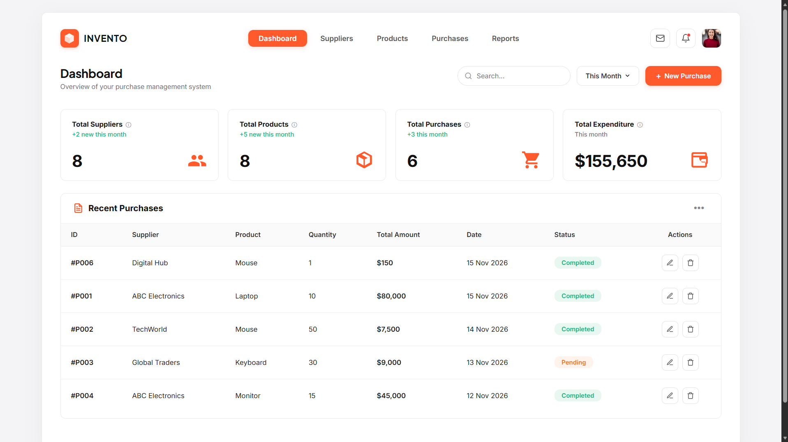

# INVENTO – Purchase Management System



**INVENTO** is a clean, modern, and professional **Purchase Management System** built on the **MERN stack** (MongoDB, Express.js, React, Node.js). Designed for university DBMS laboratory coursework, project evaluations, and viva demonstrations, it provides an intuitive web platform to manage suppliers, maintain a product catalog, record purchase transactions, and track stock levels in real time.

---

## 📸 Key Features

- **📊 Real-Time Analytics Dashboard**
  - KPI summary cards displaying **Total Suppliers**, **Total Products**, **Total Purchases**, and **Total Expenditure** computed dynamically from MongoDB.
  - Recent Purchases audit table with live status indicators (`Completed` / `Pending`) and quick action controls.

- **🏢 Supplier Management (Full CRUD)**
  - Register, view, edit, and delete verified suppliers.
  - Form validation with duplicate email checks and complete contact details (email, phone number, address).

- **👟 Product Catalog (Full CRUD)**
  - Maintain products with category tags, unit pricing, and real-time available stock quantities.
  - Stock levels dynamically update when purchase orders are recorded.

- **🧾 Purchase Orders & Automatic Calculations**
  - Record purchase transactions by selecting verified suppliers and catalog products.
  - **Automated Pricing:** Total amount is automatically calculated (`Total Amount = Quantity × Unit Price`) both on the client and validated on the Express backend.
  - **Automated Stock Increment:** Successfully recording a purchase automatically increases the product's available inventory in MongoDB.

- **📈 Reports & Transaction History**
  - Detailed financial overview of all purchase expenditures.
  - Filterable purchase log with unit pricing and supplier traceability.

- **⚡ Zero-Config Database & One-Click Demo Seeder**
  - Built-in embedded database fallback: run out of the box without manual MongoDB server setup.
  - Seed or reset the database to the reference Footwear dataset (*Nike ZoomX*, *Adidas Adizero Pro*, etc.) via a single terminal command or directly via the **"Reset Reference Data"** UI button.

---

## 🛠️ Technology Stack

| Component | Technology | Description |
| :--- | :--- | :--- |
| **Frontend** | React 18 + Vite | Modern, lightweight component architecture |
| **Styling** | Plain CSS3 | Custom Quantico/Invento theme, Plus Jakarta Sans typography |
| **Routing** | React Router v6 | Seamless single-page application navigation |
| **HTTP Client** | Axios | REST API communication with error handling |
| **Backend** | Node.js + Express.js | RESTful routing, input validation, and controllers |
| **Database** | MongoDB + Mongoose | ODM schemas, ObjectId relationships, aggregation pipelines |
| **Storage Mode** | MongoDB Atlas / Embedded Local | Zero-config persistent local engine or Atlas cloud URI |

---

## 📁 Project Structure

```text
invento-purchase-management-system/
├── backend/
│   ├── config/
│   │   └── db.js               # MongoDB connection (supports Atlas & embedded local engine)
│   ├── controllers/
│   │   ├── dashboardController.js  # KPI analytics & expenditure aggregations
│   │   ├── productController.js    # Product CRUD operations
│   │   ├── purchaseController.js   # Purchase creation & automated stock increment
│   │   └── supplierController.js   # Supplier CRUD operations
│   ├── models/
│   │   ├── Product.js          # Product Mongoose schema
│   │   ├── Purchase.js         # Purchase schema (references Supplier & Product)
│   │   └── Supplier.js         # Supplier Mongoose schema
│   ├── routes/
│   │   ├── dashboardRoutes.js  # /api/dashboard
│   │   ├── productRoutes.js    # /api/products
│   │   ├── purchaseRoutes.js   # /api/purchases
│   │   └── supplierRoutes.js   # /api/suppliers
│   ├── .env.example            # Backend environment template
│   ├── package.json            # Backend dependencies & scripts
│   ├── seed.js                 # Database seeder (Footwear / Electronics datasets)
│   └── server.js               # Express application entry point
│
├── frontend/
│   ├── src/
│   │   ├── components/
│   │   │   ├── ConfirmModal.jsx # Deletion confirmation dialog
│   │   │   ├── Modal.jsx        # Reusable modal component
│   │   │   ├── Navbar.jsx       # Top navigation bar with 3D cube logo & route pills
│   │   │   └── StatCard.jsx     # Dashboard metric card component
│   │   ├── pages/
│   │   │   ├── Dashboard.jsx    # Overview, KPIs & Recent Purchases
│   │   │   ├── Products.jsx     # Product catalog CRUD management
│   │   │   ├── Purchases.jsx    # Purchase creation & history table
│   │   │   ├── Reports.jsx      # Financial breakdown & expenditure audit
│   │   │   └── Suppliers.jsx    # Supplier directory CRUD management
│   │   ├── services/
│   │   │   └── api.js           # Centralized Axios API services
│   │   ├── App.css              # Custom responsive stylesheet
│   │   ├── App.jsx              # Main router & toast notification manager
│   │   └── main.jsx             # React DOM entry point
│   ├── .env.example             # Frontend environment template
│   ├── index.html               # Webpage HTML shell
│   ├── package.json             # Frontend dependencies & scripts
│   └── vite.config.js           # Vite development server config
│
├── .gitignore                   # Excludes node_modules, .env, and local database files
├── package.json                 # Root script runner (concurrent dev, seeding)
└── README.md                    # Project documentation
```

---

## 🚀 Getting Started

### 1. Prerequisites
Ensure you have the following installed on your machine:
- [Node.js](https://nodejs.org/) (version **18.x** or **20.x+** recommended)
- [npm](https://www.npmjs.com/) (version **9.x+** or **10.x+**)
- Git (optional, for cloning)

---

### 2. Installation

Clone the repository and install all dependencies for both frontend and backend:

```bash
# Clone the repository
git clone https://github.com/your-username/invento-purchase-management-system.git

# Navigate to project directory
cd invento-purchase-management-system

# Install all dependencies (root, backend, and frontend) in one step
npm run install:all
```

*(Alternatively, you can manually run `npm install` inside the root, `backend/`, and `frontend/` folders).*

---

### 3. Environment Variables (Optional)

Default configurations run out of the box with zero setup. If you wish to customize ports or use a remote MongoDB Atlas database, review the `.env.example` files:

#### Backend (`backend/.env`)
```env
PORT=5000
# Leave empty or set your MongoDB Atlas connection string:
MONGO_URI=mongodb://127.0.0.1:27017/invento
```
> **Note:** If no external MongoDB daemon is running, the backend automatically uses an embedded local database engine. No separate MongoDB installation is required!

#### Frontend (`frontend/.env`)
```env
VITE_API_URL=http://localhost:5000/api
```

---

### 4. Running the Application

You can launch the full stack in one simple command or run frontend and backend in separate terminals:

#### Separate Terminals

**Terminal 1 — Backend:**
```bash
cd backend
npm install
npm run dev
# or: cd backend && npm install && npm run server
```

**Terminal 2 — Frontend:**
```bash
cd frontend
npm install
npm run dev
# or: cd frontend && npm install && npm run client
```

Visit **`http://localhost:5173`** in your browser.

---

### 5. Seeding the Database

To populate the database with the reference lab dataset:

```bash
npm run seed
```

This populates the system with:
- **4 Suppliers:** Apex Footwear Distribution, Prime Athletic Imports, Metro Gear & Equipment, Pacific Sports Logistics.
- **8 Products:** Nike ZoomX ($250), Adidas Adizero Pro ($220), Nike Air Zoom Pegasus 40 ($190), Adidas Barricade Tennis ($180), NikeCourt Vapor ($210), Nike ZOOM VOMERO 5 ($128), NIKE MERCURIAL ($200), NIKE DUNK LOW ($300).
- **5 Purchases:** Order transactions `#P001` through `#P005`.

> **UI Tip:** You can also reset the database anytime with one click by clicking the **"Reset Reference Data"** button located on the top toolbar of the **Dashboard**.

---

## 📡 REST API Reference

| Method | Endpoint | Description |
| :--- | :--- | :--- |
| **GET** | `/api/dashboard` | Fetch dashboard KPI counts and 5 recent purchases |
| **GET** | `/api/suppliers` | Retrieve all registered suppliers |
| **GET** | `/api/suppliers/:id` | Retrieve a single supplier by MongoDB `_id` |
| **POST** | `/api/suppliers` | Create a new supplier record |
| **PUT** | `/api/suppliers/:id` | Update an existing supplier |
| **DELETE** | `/api/suppliers/:id` | Delete a supplier |
| **GET** | `/api/products` | Retrieve all products in the catalog |
| **GET** | `/api/products/:id` | Retrieve a single product by MongoDB `_id` |
| **POST** | `/api/products` | Create a new product record |
| **PUT** | `/api/products/:id` | Update an existing product |
| **DELETE** | `/api/products/:id` | Delete a product |
| **GET** | `/api/purchases` | Retrieve complete purchase history |
| **POST** | `/api/purchases` | Create a purchase order & automatically increment stock |
| **PUT** | `/api/purchases/:id` | Update purchase order details |
| **DELETE** | `/api/purchases/:id` | Delete a purchase order |
| **POST** | `/api/seed` | Seed or reset demo data (`type: "shoes"` or `"electronics"`) |
| **GET** | `/api/health` | Service health status check |

---

## 🎓 DBMS Viva & Demonstration Guide

When presenting this project for DBMS lab evaluations, follow this walkthrough:

1. **Dashboard Overview:** Show the live KPI cards and highlight how statistics are dynamically computed from MongoDB queries rather than static values.
2. **Supplier Registration:** Navigate to **Suppliers**, add a new supplier, and verify real-time table rendering.
3. **Product Inventory:** Navigate to **Products**, point out the current available stock for a product (e.g., `Nike ZoomX: 33 units`).
4. **Create a Purchase Transaction:**
   - Go to **Purchases** and click **+ New Purchase**.
   - Select the supplier and product.
   - Enter a quantity (e.g., `10 units`).
   - Observe the automatic client calculation: `10 × $250 = $2,500`.
   - Submit the order.
5. **Verify Database Integrity:**
   - Return to **Products** and demonstrate that the quantity of `Nike ZoomX` automatically incremented from `33` to `43`.
   - Point out the newly generated purchase order in **Recent Purchases** and **Reports**.
6. **Relational Reference (Foreign Keys):** Explain that the `Purchase` collection references `Supplier` and `Product` using Mongoose `ObjectId` references (`ref: 'Supplier'`, `ref: 'Product'`) and resolves them with `.populate()`.

---

## 📜 Available NPM Scripts

| Command | Purpose |
| :--- | :--- |
| `npm run dev` | Runs backend API and frontend Vite dev server concurrently |
| `npm run server` | Starts the Express backend on port 5000 |
| `npm run client` | Starts the Vite frontend on `http://localhost:5173` |
| `npm run seed` | Seeds the reference Footwear/Shoes dataset into MongoDB |
| `npm run seed:shoes` | Seeds the reference Footwear dataset |
| `npm run seed:electronics` | Seeds alternative Electronics dataset |
| `npm run build` | Builds optimized production bundle in `frontend/dist` |
| `npm run install:all` | Installs dependencies across root, backend, and frontend |

---

## 📄 License

This project is licensed under the **MIT License**. Created for academic demonstration and laboratory coursework.
